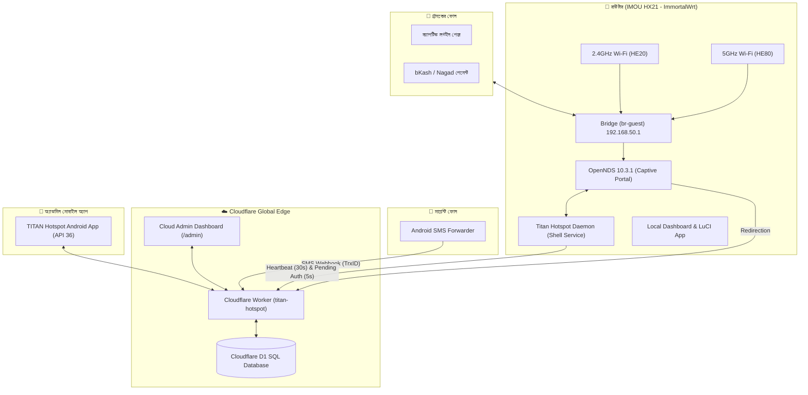

# ⚡ TITAN Hotspot & Payment Gateway (Next-Gen Wi-Fi Captive Portal)

> **সম্পূর্ণ স্বয়ংক্রিয়, ক্লাউড-নিয়ন্ত্রিত, ডুয়াল-ব্যান্ড Wi-Fi 6 হটস্পট বিলিং ও ম্যানেজমেন্ট সিস্টেম।**
> তৈরি করা হয়েছে **IMOU HX21 (ImmortalWrt / OpenWrt)**, **Cloudflare Workers (Edge Serverless)**, **Cloudflare D1 (SQL)** এবং **অ্যান্ড্রয়েড ১৬ সাপোর্টেড নেটিভ মোবাইল অ্যাপ** সমন্বয়ে।

---

## 🌟 মূল বৈশিষ্ট্যসমূহ (Key Highlights)

- 📶 **ডুয়াল-ব্যান্ড Wi-Fi 6 (2.4GHz + 5GHz 80MHz):** উভয় ব্যান্ড একই নেটওয়ার্ক নামে (`WIFI HOTSPOT JOIN TO PURCHASE`) সম্প্রচারিত। 5G সক্ষম ফোনগুলো স্বয়ংক্রিয়ভাবে গিগাবিট স্পিড পায়।
- 🌐 **ক্লাউড ক্যাপটিভ পোর্টাল (Cloudflare FAS):** ক্লাউডফ্লেয়ারের গ্লোবাল এজ নেটওয়ার্কে হোস্ট করা আধুনিক মোবাইল-ফ্রেন্ডলি লগইন ও পেমেন্ট পেজ।
- 📱 **অটো bKash / Nagad SMS ভেরিফিকেশন:** মার্চেন্ট ফোনে টাকা আসা মাত্রই Android SMS Forwarder থেকে Webhook-এর মাধ্যমে bKash TrxID স্বয়ংক্রিয়ভাবে ম্যাচ হয়ে তাৎক্ষণিক ইন্টারনেট চালু হয়।
- ⏱️ **স্মার্ট ব্যবহার-ভিত্তিক সময় ট্র্যাকিং (Usage-Based Accounting):** ক্লায়েন্ট ওয়াইফাই থেকে ডিসকানেক্ট থাকলে তার প্যাকেজের সময় নষ্ট হওয়া বন্ধ (Pause) থাকে; পুনরায় কানেক্ট হলে সময় গণনা চালু হয়।
- 📊 **লাইভ কাস্টমার স্ট্যাটাস পেজ (`/status`):** গ্রাহক যেকোনো সময় তার অবশিষ্ট সময় দিন-ঘণ্টা-মিনিট-সেকেন্ড আকারে লাইভ দেখতে পারেন।
- ☁️ **গ্লোবাল রিমোট কন্ট্রোল (যেকোনো জায়গা থেকে নিয়ন্ত্রণ):** পাবলিক আইপি বা পোর্ট ফরোয়ার্ডিং ছাড়াই ক্লাউডের মাধ্যমে বিশ্বের যেকোনো প্রান্ত থেকে রাউটার কন্ট্রোল।
- 📱 **অ্যান্ড্রয়েড ১৬ সাপোর্টেড নেটিভ মোবাইল অ্যাপ:** Material 3 ডার্ক থিম, লাইভ ইউজার ট্র্যাকিং, এক ক্লিকে পারমিশন (`+২ ঘণ্টা`, `+১ দিন`), ডিভাইস কিক ও পিন সিকিউরিটি।

---

## 🏗️ সিস্টেম আর্কিটেকচার (System Architecture)



---

## 📂 প্রোজেক্টের ফাইল স্ট্রাকচার

```
imou-hx21-hotspot/
├── titan-hotspot-cloudflare/       # Cloudflare Worker & D1 Backend
│   ├── src/
│   │   └── index.js               # Worker API, Webhooks, Web Admin, Portal
│   ├── schema.sql                 # D1 Database Schema
│   └── wrangler.jsonc             # Cloudflare Deployment Config
├── TitanHotspotApp/               # Android 16 Native Admin App (Java / Material 3)
│   ├── app/src/main/
│   │   ├── java/com/titano/hotspotadmin/
│   │   │   ├── MainActivity.java  # Dashboard, Live Clients, Remote Actions
│   │   │   ├── LoginActivity.java # PIN Authentication
│   │   │   ├── ApiClient.java     # Cloud REST API Client
│   │   │   ├── ClientAdapter.java # Wi-Fi Clients RecyclerView
│   │   │   ├── InvoiceAdapter.java# Invoices RecyclerView
│   │   │   └── Models.java        # Data Models
│   │   ├── res/                   # Layouts, Drawables, Mipmaps, App Logo
│   │   └── AndroidManifest.xml    # App Manifest (API 24 to 36)
│   └── build.gradle.kts           # Gradle Build Config
├── router-scripts/
│   ├── titan-hotspot-daemon.sh    # Router background sync & heartbeat service
│   ├── hotspot-api                # Router uhttpd CGI backend
│   └── hotspot.html               # Local Admin Panel UI
├── TITAN_Hotspot_Admin.apk        # Compiled Android APK
└── README.md                      # A to Z Project Documentation
```

---

## ⚙️ কনফিগারেশন ও ইনস্টলেশন গাইড

### ১. রাউটার সেটআপ (OpenWrt / ImmortalWrt)

#### ক. নেটওয়ার্ক ব্রিজ (`br-guest`):
```sh
uci set network.br_guest=device
uci set network.br_guest.name='br-guest'
uci set network.br_guest.type='bridge'
uci set network.guest=interface
uci set network.guest.device='br-guest'
uci set network.guest.proto='static'
uci set network.guest.ipaddr='192.168.50.1/24'
uci commit network
/etc/init.d/network reload
```

#### খ. ডুয়াল-ব্যান্ড Wi-Fi (2.4G ও 5G):
```sh
# 2.4 GHz Guest AP
uci set wireless.guest_radio0=wifi-iface
uci set wireless.guest_radio0.device='radio0'
uci set wireless.guest_radio0.network='guest'
uci set wireless.guest_radio0.mode='ap'
uci set wireless.guest_radio0.ssid='WIFI HOTSPOT JOIN TO PURCHASE'
uci set wireless.guest_radio0.encryption='none'
uci set wireless.guest_radio0.isolate='1'

# 5 GHz Guest AP
uci set wireless.guest_radio1=wifi-iface
uci set wireless.guest_radio1.device='radio1'
uci set wireless.guest_radio1.network='guest'
uci set wireless.guest_radio1.mode='ap'
uci set wireless.guest_radio1.ssid='WIFI HOTSPOT JOIN TO PURCHASE'
uci set wireless.guest_radio1.encryption='none'
uci set wireless.guest_radio1.isolate='1'
uci commit wireless
wifi reload
```

#### গ. OpenNDS কনফিগারেশন:
```sh
uci set opennds.@opennds[0].gatewayinterface='br-guest'
uci set opennds.@opennds[0].gatewayname='WIFI HOTSPOT JOIN TO PURCHASE'
uci set opennds.@opennds[0].login_option_enabled='1'
uci set opennds.@opennds[0].gatewayfqdn='disable'
uci set opennds.@opennds[0].walledgarden_fqdn_list='titan-hotspot.titano.workers.dev'
uci set opennds.@opennds[0].walledgarden_port_list='443'
uci commit opennds
/etc/init.d/opennds restart
```

#### ঘ. রাউটার ব্যাকগ্রাউন্ড সার্ভিস চালু করা:
```sh
# ডেমন স্ক্রিপ্ট প্লেস করা
chmod +x /usr/bin/titan-hotspot-daemon.sh

# সার্ভিস চালু ও এনেবল করা
/etc/init.d/titan-hotspot enable
/etc/init.d/titan-hotspot start
```

---

### ২. ক্লাউড ব্যাকএন্ড ডিপ্লয়মেন্ট (Cloudflare)

```bash
cd titan-hotspot-cloudflare

# D1 ডাটাবেস টেবিল তৈরি
npx wrangler d1 execute titan-hotspot-db --remote --file=./schema.sql

# ক্লাউডফ্লেয়ার ওয়ার্কার ডিপ্লয়
npx wrangler deploy
```

---

### ৩. SMS Forwarder সেটআপ (অটো ভেরিফিকেশন)

1. মার্চেন্ট ফোনে **SMS Forwarder** অ্যাপটি ইনস্টল করুন।
2. নতুন Webhook রুল তৈরি করুন:
   - **Target URL:** `https://titan-hotspot.titano.workers.dev/API/webhook/sms?secret=titan_sms_secret_2026`
   - **Method:** `POST`
   - **Header:** `X-SMS-Secret: titan_sms_secret_2026`
   - **Payload:**
     ```json
     {
       "sender": "[from]",
       "message": "[content]",
       "timestamp": "[timestamp]"
     }
     ```

---

### ৪. অ্যান্ড্রয়েড মোবাইল অ্যাপ বিল্ড ও ব্যবহার

- অ্যাপ সোর্স কোড `TitanHotspotApp` ফোল্ডারে রয়েছে।
- সরাসরি Android Studio দিয়ে ওপেন করে অথবা টার্মিনালে `./gradlew assembleDebug` রান করে APK তৈরি করা যায়।
- প্রস্তুতকৃত APK: `TITAN_Hotspot_Admin.apk`।
- **ডিফল্ট অ্যাডমিন পিন:** `7890`

---

## 🎯 ৩ টি স্তরের অ্যাডমিন কন্ট্রোল সিস্টেম

| কন্ট্রোল ইন্টারফেস | কীভাবে ব্যবহার করবেন | কাজের পরিধি |
| :--- | :--- | :--- |
| **১. অ্যান্ড্রয়েড মোবাইল অ্যাপ** | ফোনে ইনস্টল করা `TITAN Hotspot Admin` অ্যাপ | যেকোনো স্থান থেকে লাইভ মনিটরিং, এক ক্লিকে পারমিশন, ডিভাইস কিক, ভাউচার সার্চ। |
| **২. ক্লাউড ওয়েব অ্যাডমিন** | ব্রাউজারে `https://titan-hotspot.titano.workers.dev/admin` (পিন: 7890) | যেকোনো কম্পিউটার/মোবাইল থেকে ইন্টারনেট ব্রাউজারের মাধ্যমে সম্পূর্ণ কন্ট্রোল। |
| **৩. লোকাল রাউটার প্যানেল** | রাউটার ব্রাউজারে `http://192.168.1.1/hotspot.html` বা LuCI (Services ➔ TITAN Hotspot) | লোকাল নেটওয়ার্কে রাউটারের ভেতরের নিজস্ব অ্যাডমিন প্যানেল। |

---

## 💡 ভবিষ্যৎ উন্নয়ন ও কিছু গুরুত্বপূর্ণ সাজেশন (Recommendations)

1. **ব্যান্ডউইডথ রেট লিমিটিং (QoS / CAKE / OpenNDS Rate Limiting):**
   - প্রতি গ্রাহকের জন্য নির্দিষ্ট স্পিড (যেমন: 5 Mbps / 10 Mbps) নির্ধারণ করে দিলে একক কোনো ইউজার সম্পূর্ণ ব্যান্ডউইডথ দখল করতে পারবে না।
   - OpenNDS-এর `download_rate_limit_threshold` ও `upload_rate_limit_threshold` সক্রিয় করা যেতে পারে।

2. **কাস্টম ডোমেইন ব্র্যান্ডিং (Custom Domain with SSL):**
   - `workers.dev` ডোমেইনের পরিবর্তে আপনার নিজস্ব কাস্টম ডোমেইন (যেমন: `wifi.titano.com` বা `hotspot.yourdomain.com`) Cloudflare-এ যুক্ত করলে ব্র্যান্ডিং আরও আকর্ষণীয় দেখাবে।

3. **স্বয়ংক্রিয় মেয়াদোত্তীর্ণ SMS অ্যালার্ট:**
   - ইউজারের মেয়াদ শেষ হওয়ার ১৫ মিনিট আগে একটি রিমাইন্ডার পাঠানোর ব্যবস্থা যুক্ত করা যেতে পারে।

4. **D1 ডাটাবেস অটো ব্যাকআপ:**
   - ক্লাউডফ্লেয়ারের ফ্রি ক্রন ট্রিগার (`scheduled` event) দিয়ে প্রতিদিনের ট্রানজেকশন ব্যাকআপ রাখা নিরাপদ।
